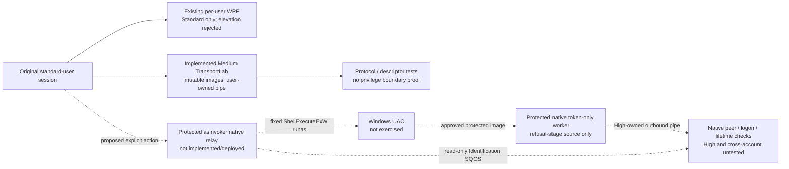

# 0.6.5 independent security review brief — not an acceptance certificate

Classification **B**. No independent review has occurred. Native compilation, protected deployment, real UAC/cross-account IPC and removal remain blocked by [environment readiness](0_6_5_ENVIRONMENT_READINESS.md). Read [the milestone report](MILESTONE_0_6_5_REPORT.md), threat model and protocol before approving implementation/testing. Automated tests do not close these boundaries.

## Boundary and implemented scope

Same-user compromise remains in scope for rejecting arbitrary privileged operations, not for confidentiality of data delivered to that session. On-disk protection cannot make the original user's runtime session trustworthy. Full malicious administrator/kernel/signing compromise remains outside containment. No trust assumption was relaxed in 0.6.5; inability to test a Windows mechanism is not evidence it failed or succeeded.

## Executable and dependency inventory

| Item | Actual state | Review requirement |
| --- | --- | --- |
| Native Worker.cpp + Request.h | Uncompiled C++20 source; own primary token only, unconditional protected-deployment refusal | Compile with approved MSVC/SDK, review all warnings, validate parser/static assertions and actual token failures |
| Native worker PE / imports | **No native executable exists** | Inspect actual PE x64/manifest/imports/load config; verify static CRT and System32 import-search flags; trace dependencies/forwarders under hostile CWD/PATH |
| Protected native relay | Not implemented | Fixed UAC launch only, retained exact handle, safe original-user/lifetime binding; no user paths/credentials |
| Current Worker/Relay managed apphost + DLL + runtimeconfig/deps | Ordinary-user refusal test builds; unsigned, mutable, not authorised privileged inventory | Do not elevate/deploy them; .NET startup precedes application guards |
| TransportLab, Readiness, PolicyTests | Ordinary-user tests only, not privileged package components | Verify no credential/account identifiers in output; all require Medium primary token |
| Execution policy/security epoch metadata | No protected policy or signing anchor exists | Approved publisher/product, exact compatible inventory, security epoch/minimum version and offline trust policy; no user-writable manifest trust root |
| OS libraries/runtime | Trusted OS assumption, not a measured complete load inventory | Native draft statically links CRT and requests system-library imports; actual full dependency inventory/load trace pending |

Managed test executable/DLL hashes and signature state are recorded in the milestone report solely to identify evidence. They are not an authorisation mechanism, signing substitute or complete runtime inventory. Native static CRT and `/DEPENDENTLOADFLAG:0x800` are build settings until actual PE inspection proves them; [Microsoft's linker documentation](https://learn.microsoft.com/en-us/cpp/build/reference/dependentloadflag?view=msvc-170) describes their limited scope.

## APIs and checks

| Responsibility | APIs / implementation | Evidence |
| --- | --- | --- |
| Own native primary token | GetCurrentProcess, OpenProcessToken(TOKEN_QUERY), GetTokenInformation(TokenType/Elevation/IntegrityLevel/Groups), IsValidSid, IsWellKnownSid, CloseHandle | C++ source uncompiled; existing managed Win32 own-token observation/refusal tested Medium |
| Retained peer identity | OpenProcess(QUERY_LIMITED_INFORMATION/SYNCHRONIZE), GetProcessTimes, GetProcessId, QueryFullProcessImageName, WaitForSingleObject; token logon/session facts remain in memory | Medium only; image-path equality is not protected file identity |
| Pipe creation/client rights | CreateNamedPipeW outbound/overlapped/first-instance/local-only/one instance; CreateFileW specific read rights with Identification SQOS | Actual Medium transport tests; no High creation or cross-account access |
| Endpoint association | GetNamedPipeClient/ServerProcessId and Client/ServerSessionId with held processes/start times | Medium wrong-peer/session/stale-claim tests; no forced PID reuse |
| Descriptor contents | ConvertStringSecurityDescriptorToSecurityDescriptorW in memory; GetSecurityInfo OWNER/DACL/LABEL on own Medium pipe; exact policy validator | 21 policy tests plus Medium read-back/open/denial; not an effective-access proof for protected objects |
| Known folder | SHGetKnownFolderPath(ProgramFiles) | Actual Medium environment-independence test; no trusted filesystem path proof |
| UAC | Required ShellExecuteExW(runas), fixed protected EXE, SEE_MASK_NOCLOSEPROCESS and exact handle/lifetime validation | **Not implemented/exercised**; no fallback |

The C++ own-token routine accepts success only after all facts were obtained; an admin group without actual elevation/High integrity fails. It adjusts no privilege, reads no credentials, opens no other process memory and emits no token/result before protected/authenticated transfer. Its successful transfer path is absent. The native parser accepts only the existing six canonical pairs and token-probe-v1; it never treats relay PID/start/session strings as authentication.

## Descriptor policy under review

The High candidate is `O:BAD:P(A;;FA;;;SY)(A;;FA;;;BA)(A;;0x00120089;;;<original-logon>)S:(ML;;NW;;;HI)`; SYSTEM owner is also permitted by the validator. The logon identifier must be obtained from the retained original relay's Windows primary token, never a caller string. Do not equate it with the elevated administrator's account/SID/profile.

Validator requires protected, present, non-null DACL with exactly SYSTEM/Admin full rights and original-logon read-data/EA/attributes/read-control/synchronise. It rejects extra, duplicate, inheritable/callback/deny entries, write/create-instance/WRITE_DAC expansion, missing/wrong High label or policy and non-logon identity. This validates **contents** of bytes only, not who owns a real pipe or who may effectively use it. High creation without extra privilege, effective owner/DACL/MIC, denied unrelated account/session/remote clients, no privileged token/handle disclosure and original-logon cross-account reads remain mandatory A/X tests.

Medium laboratory ownership/label is separate and cannot satisfy High validation. The real Medium read-back now uses the shared stricter validator, including the DACL-protected bit. No High endpoint is created by these tests. Account/logon values stay transient; only well-known principals and synthetic/non-identifying cases appear in source.

## Proposed administrator-only installation/removal transaction

This is a **design**, not an installer or permission evidence. No runnable privileged deployment/removal command is supplied while environment/signing gates are closed.

1. An approved admin/enterprise authority authorises the exact reviewed signed package; an unsigned exception would require a separately documented isolated-lab policy, which is currently absent. Verify publisher/product/security epoch/inventory against an administrator-controlled anchor before execution. Reject unknown/offline trust unless an explicit enterprise offline policy covers it; never silently relax WDAC/AppLocker/endpoint controls.
2. Resolve Program Files through Windows; proposed immutable root follows the architecture: `WPBD\Broker\1\0.6.5`. Accept **no caller installation/deletion/script/DLL/output path**. Open/retain final directory/file identities and reject reparse/UNC/device/redirection or unexpected existing objects. Verify every ancestor's effective owner/write/delete-child/DACL/owner-changing rights.
3. Use admin-only staging, no user temp extraction. SYSTEM/Administrators control maintenance; authorised ordinary users have read/execute only. Validate every package member, dependency and execution-affecting policy/manifest before activation. No editable per-user active-version/checksum root. Protect version/epoch/update policy as part of the inventory.
4. Activate only a complete immutable version, atomically and with an approved minimum security epoch. Do not replace a version held by an active session. Interrupted staging remains inactive; recover only through the same authorised identity-checked transaction. Test rollback only to an approved non-revoked compatible version, never below the security floor.
5. Removal targets only the compiled/reviewed inventory and fixed version root, by verified final identities. Reject arbitrary targets, any unsupported reparse/ancestor substitution or unexpected content. Preserve unrelated files and report incomplete removal; do not recursively follow user-controlled paths or claim success while silently leaving protected components. Coordinate active exact sessions with bounded exit; do not kill caller PIDs or leave a privileged service/task behind.
6. In the disposable VM, originating and second standard accounts must actually fail create/write/append/replace/delete/rename/parent-delete-child/WRITE_DAC/WRITE_OWNER/dependency substitution attempts. Admin maintenance and complete removal must work without weakening those denials. Record actual ACL/owner/inheritance, binary identities and outcomes, not only SDDL strings. Crash/interruption/upgrade/active-session/removal tests require independent review evidence.

No effective filesystem permissions for a protected package are available because no package exists. Current work makes no enterprise-deployment assurance claim. Application history/reports stay untouched; the privileged worker will stream only its token result, never accept a destination or create privileged report/temp files.

## Acceptance questions still open

- Can the real worker derive/hold original relay token/logon/session/image facts across accounts without unsafe extra privileges, and can the relay validate its exact UAC-launched worker with protected file identity?
- Can the actual High owner/DACL/MIC be created and read back correctly, with only the intended low read access and no impersonation/handle disclosure?
- Does static startup/load tracing exclude writable code/dependencies before application guards, under hostile CWD/PATH/environment and enterprise controls?
- Do native consent/cancellation/incorrect credentials/policy denial/early exit/late approval, absolute deadlines and relay loss leave no orphan or successful incomplete result?
- Do signed deployment, epoch/rollback and fixed safe removal survive substitution, active sessions and interruption as both standard accounts?

These questions require real A/X evidence, not more mocked tests. All G01–G12 remain blocking; no reviewer sign-off or production enablement is implied by this brief.
