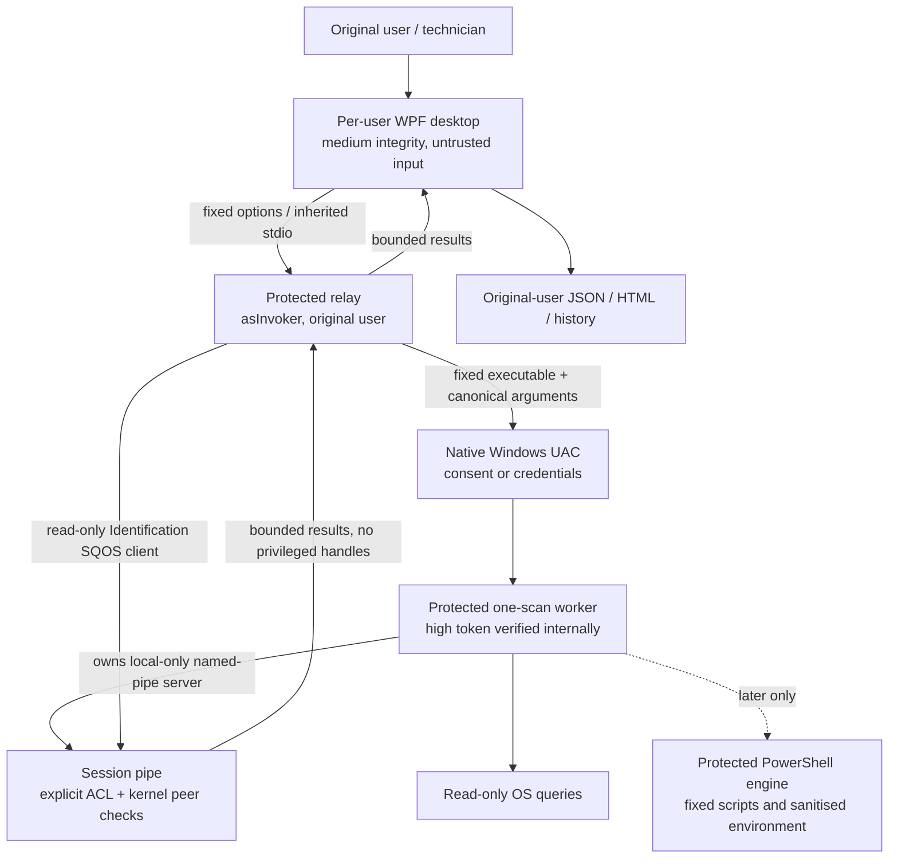

# Elevated diagnostics architecture — proposed, not enabled

Decision record, 19 November 2026. Milestone 0.6.3; shipped application remains 0.6.2. Production code, rejection gate, installer and classification engine are unchanged. [Threat model](ELEVATED_DIAGNOSTICS_THREAT_MODEL.md) defines the limits of this design.

## 0.6.4 implementation status — partial proof of concept (B)

The [0.6.4 report](MILESTONE_0_6_4_REPORT.md) records real **Medium-to-Medium** Windows pipe tests, native primary-token/process observations and refusal-stage relay/worker entry points in `experiments/elevation-worker`. There is no protected deployment, UAC launch, successful elevated worker operation or authenticated cross-account channel. The host has no detected native C++/Windows SDK toolchain or established disposable multi-account administrator lab. Managed outputs cannot substitute for the proposed native privileged entry point; publish is blocked and the protected-deployment gate is unconditional.

No trust assumption is relaxed. The lab's original-user-owned **Medium** pipe is a separate test object under `WPBD.Experimental.Medium.v1`, not the candidate high/admin-owned endpoint. A user's implicit owner rights and user-writable images prevent promoting those tests into protected-peer authentication evidence. There is no `ShellExecuteExW` implementation yet: native UAC integration is deferred until a reviewed protected inventory exists. A fixed, reviewed admin install/remove package remains unimplemented; no protected components are left behind. The prompt authorises experimental admin-controlled lifecycle testing in a suitable disposable lab; it does not close product deployment, signing or effective-access gates.

## Recommendation: Option B, protected optional broker package

Keep the existing per-user desktop and Standard engine. Separately deploy an administrator-protected package containing a small **asInvoker relay** and a **one-scan elevated worker**. Prefer a native/AOT supervisor for the privileged entry point so a managed startup hook cannot run before validation. Full diagnostics would retain the authoritative PowerShell analysis only after every script/module/runtime load is protected and traced. The first privileged implementation should support only a native token probe.

This is a conditional recommendation, not deployment approval. Protected-component installation, update and removal require an administrator/enterprise deployment authority. Ordinary desktop uninstall remains per-user; machine-component removal must be explicit and separate, never a hidden leftover or worker self-delete command. If the product requires every component to be removable by an ordinary user without any privileged deployment operation, **that conflicts with a protected machine component and remains a product release blocker**. Do not weaken ACLs to meet that requirement.

The worker is the high-integrity pipe **server**, not a privileged client of a user-created server. This reduces token-impersonation exposure. A protected relay provides a stable versioned launch/transport component independent of per-user UI updates; it is still untrusted at runtime if the user's own session is compromised. Arbitrary privileged operations must remain impossible even after relay compromise.

## Options evaluated

| Property | A: entire application in Program Files | B: per-user desktop + protected relay/worker | C: on-demand service or COM/RPC broker |
| --- | --- | --- | --- |
| Code integrity | Protects all installed code if effective ACLs/dependencies are correct | Protects privileged code without treating per-user presentation as trusted | Protected executable, registration and service/broker ACLs required |
| Installation / approval | Admin-managed installation/update for desktop too | Standard install stays ordinary; optional broker package admin-managed; native UAC per scan | Admin registration/install; broker authorisation can diverge from per-scan UAC |
| Cross-account | Still needs authenticated transport and original-user storage | Explicit separation between worker account and original-user relay | Windows RPC/COM authentication is useful but not a substitute for narrow interfaces |
| Updates | One protected compatibility set; all updates need authority | Two package cadences; protected protocol/security-epoch compatibility policy | Registration, service identity and interface lifecycle add complexity |
| Dependencies | Smaller deployment ambiguity; larger protected inventory | Small native trusted supervisor; protected diagnostic bundle later | Service/runtime/plugin dependency chains remain security-critical |
| UX | Ordinary run is non-elevated; ordinary self-update/uninstall changes | Current Standard UX preserved; optional feature clearly unavailable until deployed | Background lifetime and failure recovery less visible to technician |
| Enterprise | Familiar managed deployment | Separate broker deployment, publisher policy and per-user UI supported | Good where a managed broker already exists, but another privileged agent is not currently justified |
| Uninstall | Protected app removal requires authority | Desktop removal ordinary; protected component removal separately managed | SCM/COM removal requires authority and lifecycle coordination |
| Maintenance / residual risk | Disk protection does not stop same-user runtime injection | More version negotiation, but least new privileged surface for one-scan use | Broad ACL/control mistakes can become persistent privilege escalation |

Reject A as the default recommendation because it changes the existing per-user install/update/removal model unnecessarily. It remains a reasonable enterprise packaging alternative. Reject C for this milestone: a persistent LocalSystem service is unnecessary; even an on-demand broker adds registration and privileged lifecycle interfaces. Do not grant ordinary users configuration/change-control rights. [Microsoft service access guidance](https://learn.microsoft.com/en-us/windows/win32/services/service-security-and-access-rights) identifies configuration rights as security-sensitive. Local RPC/COM may be reconsidered if native pipe authentication proves unsuitable; they do not remove the deployment or compromised-client problem.

## Protected component inventory and ACL policy

Proposed root: the system-resolved Program Files location plus `WPBD/Broker/<security-epoch>/<version>`. Do not use a caller path, PATH search, user environment expansion or HKCU registration. Resolve known folders through Windows, not a hard-coded drive letter.

| Component | Intended protection / ownership |
| --- | --- |
| Relay, worker, native DLLs, manifests, runtime configuration | Administrators/SYSTEM or approved deployment service own/write; authorised ordinary users read/execute only; no user/group Modify, WriteData, AppendData, Delete, DeleteChild, WriteDac or WriteOwner |
| Future engine entry point, scripts, modules, format/spec data affecting execution | Same protected version root and approved inventory; never import the per-user Engine directory |
| Minimum security epoch, publisher/compatibility policy, active-version pointer | Machine-protected HKLM or protected machine-data ACL; no HKCU fallback; no caller editing |
| Update staging / rollback inventory | Admin-controlled, protected staging; verify before activation; no low-user temp extraction or custom elevated installer action supplied by a user |
| Reports and ordinary preferences | Original user's existing locations; never writable by the worker as a result of a supplied destination |

Validate effective access, owner, inherited ACEs and **all ancestors**, including delete/rename rights, not a string prefix or a folder called Program Files. Do not add indiscriminate deny ACEs that break SYSTEM/deployment servicing. Reject unexpected reparse points, UNC/device paths and execution aliases. Compare final paths, volume/file IDs and held file/directory handles; a canonical string alone does not close TOCTOU. Protected version directories remain immutable during active scans. Coordinate updates with retained process/file references and validate crash recovery.

For managed workers, the protected inventory must include apphost, hostfxr/CoreCLR, deps/runtimeconfig, managed assemblies, native DLLs, configuration and any extraction location. Native/AOT reduces this inventory; it does not remove native-loader/search risks. Constrain DLL directories and use absolute approved loads; no CWD/PATH plugins. [DLL security](https://learn.microsoft.com/en-us/windows/win32/dlls/dynamic-link-library-security) explains the underlying search risk.

Authenticode is complementary: verify an approved publisher/product and security epoch, not merely any valid signature. Validate signed packages and their protected inventory, timestamp/revocation policy and rollback floor. [WinVerifyTrust](https://learn.microsoft.com/en-us/windows/win32/api/wintrust/nf-wintrust-winverifytrust) supplies trust validation, not application-specific publisher authorisation. No user-writable hash list is a trust anchor. Use documented cache-only/offline trust policy by default; do not introduce diagnostic uploads or silently disable revocation. Unknown offline trust/revocation status must fail closed pending an approved enterprise policy. Signer rotation, revoked/expired certificates, offline deployment and WDAC/AppLocker rules are G02/G03 blockers.

## Native UAC sequence and privilege checks

1. Desktop starts the fixed protected relay non-elevated with only allowed duration/interval/profile. Relay verifies its deployment, rejects elevated invocation and generates a fresh session.
2. Relay invokes the fixed protected worker using ShellExecuteExW `runas`, requests a retained process handle and constructs only canonical fixed tokens. No account name/password enters WPBD. No stored credentials or custom password form.
3. Retain the exact launch handle. No handle, refusal, cancellation, policy block or uncertain launch means no scan. Never retry with a service, task or alternate credential mechanism. [SHELLEXECUTEINFO](https://learn.microsoft.com/en-us/windows/win32/api/shellapi/ns-shellapi-shellexecuteinfow) documents process-handle handling; a numeric PID alone is not enough.
4. Worker verifies its own primary token and its protected deployment before opening the endpoint. Administrator membership alone is insufficient. Worker derives relay identity/session from a held kernel process handle, cross-checking the supplied creation time and protected relay image/version. If required cross-account queries fail, exit rather than substitute caller claims.
5. Worker creates the local-only session server and performs the [protocol](ELEVATED_DIAGNOSTICS_IPC_PROTOCOL.md) handshake. Configuration is frozen, one operation only. A minimal trusted worker scope/recipient confirmation is recommended before returning privileged metadata; it is never a credential form. It cannot make a compromised user session trustworthy.
6. On completion/cancel/failure, worker exits and releases handles; relay returns only validated bounded data to the original desktop.

An administrator may receive consent; a standard user may supply separate administrator credentials through Windows; wrong credentials/denial may remain inside Windows or surface as launch errors. Do not conflate these cases or log privileged identities. Prefer dedicated workstation-support administrators rather than broad domain-administrator use. Do not change machine UAC/AppLocker/WDAC/endpoint-security policy to make a scan work.

Account identity can change with Windows Administrator protection; do not assume the elevated account/profile/SID is the interactive user or a fixed administrator. Treat that platform as an explicit compatibility test, not universally available behaviour. See [Microsoft Administrator protection](https://learn.microsoft.com/en-us/windows/security/application-security/application-control/administrator-protection/). No policy toggling is part of this milestone.

## Engine and result lifecycle

The first privileged proof must return only native token facts. Later, retain one authoritative PowerShell diagnostic engine in the protected bundle. Launch only the system Windows PowerShell binary with fixed protected script paths, NoProfile/NonInteractive, a sanitised environment and controlled module resolution. Trace every assembly/script/module load, including profiles, module auto-loading, type/format files, working directory, startup hooks/profilers, PSModulePath and temporary compilation. Do not accept caller execution-policy, module, script, environment or DLL-search overrides. A secure replacement for dynamic native-helper compilation is a release gate. Stop if policy blocks execution; no bypass recommendation or SeDebug enabling.

Freeze the supported release/engine/schema relationship; version compatibility is explicit, not "latest found". Transfer progress and complete JSON to the relay without privileged report/temp destinations. Validate framing, budget, digest, schema, sample counts and completion before the desktop saves its existing JSON/HTML pair under ordinary permissions. Sender identity does not excuse malformed data. No raw privileged process/token handle is transferred. Results can disclose other users' executable paths; minimise fields, protect the pipe, warn the technician, and never claim secrecy once delivered to a compromised recipient.

## Milestone boundary

The five documents define a candidate design. An isolated memory-stream protocol-conformance harness may validate syntax/bounds/order and read its own unprivileged token. It is **not** a privileged IPC proof. Protected installation, mutual Windows peer authentication, actual UAC and separate-account handling remain blocked until real administrator-controlled tests are available. Production source and installer must not reference experimental code.
